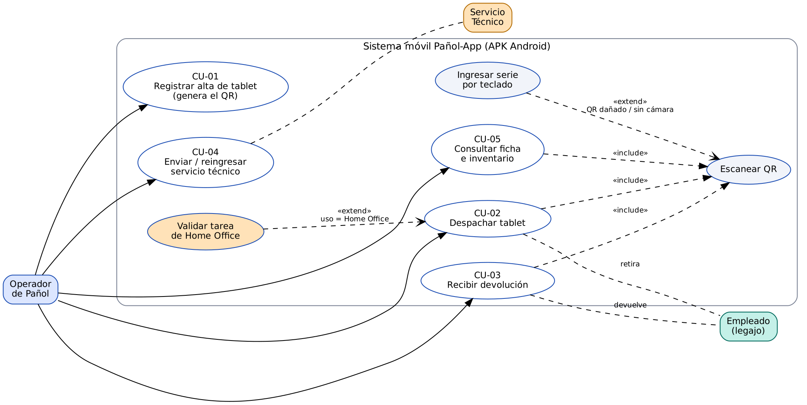
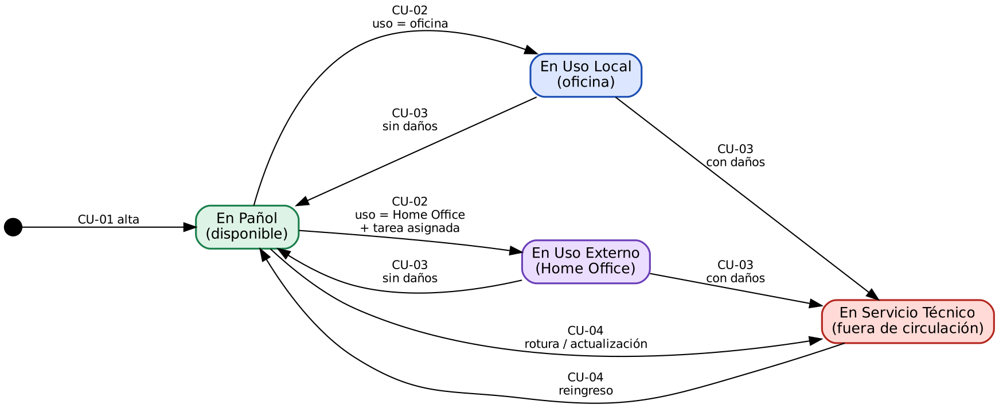
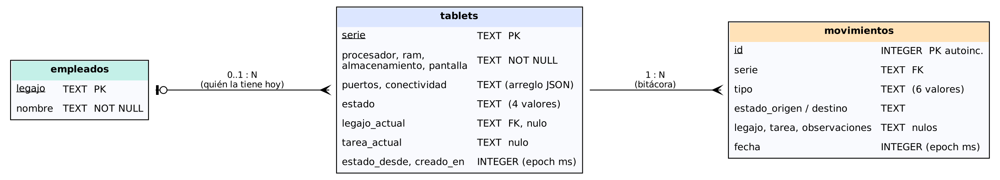

**Asignatura:** Desarrollo de Sistemas · **Institución:** Escuela Técnica N° 1 "Otto Krause"
**Entregable:** `panol_app.apk` (Android 8.0 o superior) + esta carpeta técnica

# 1. Introducción y reutilización del TP anterior

El TP anterior controlaba cintas LTO-7 que **no se movían**: una cinta, una ubicación fija. Este TP migra esa lógica a tablets que **se mueven con personas**. Se reutilizó:

| TP de cintas | Pañol-App |
|---|---|
| Estados: Libre, Asignada, Dañada, Archivada | 4 estados: En Pañol, Uso Local, Uso Externo (Home Office), Servicio Técnico |
| Regla clave: una cinta está en **una sola ubicación** a la vez | Una tablet está en **un solo estado** a la vez; las transiciones están restringidas (sección 5) |
| Escaneo simulado por teclado | Escaneo real con la cámara (QR); el teclado queda como **flujo alternativo** |
| Casos de uso expandidos | CU-01 a CU-03 (más CU-04 y CU-05 de soporte) |

## Enfoque híbrido

- **Fase 1 — base predictiva (estilo cascada):** casos de uso, reglas de negocio, matriz de estados y diseño del almacenamiento quedaron definidos *antes* de programar (secciones 3 a 6). Eran requisitos estables.
- **Fase 2 — base ágil e incremental:** el desarrollo se hizo en dos sprints, cada uno con un producto usable (sección 8).

# 2. Diagrama de casos de uso



# 3. Matriz de estados y transiciones



# 4. Casos de uso expandidos

## CU-01 — Registrar alta de tablet en el pañol (genera el QR)

| Campo | Detalle |
|---|---|
| **Actor principal** | Operador de Pañol |
| **Objetivo** | Incorporar una tablet nueva al sistema y obtener su etiqueta QR |
| **Precondiciones** | La app está abierta. El número de serie **no** existe en la base |
| **Disparador** | Botón *Alta*, o escaneo/ingreso manual de una serie desconocida (la app ofrece darla de alta con los datos del QR precargados) |
| **Postcondiciones** | Tablet creada en estado **En Pañol**; movimiento `ALTA` registrado; etiqueta QR generada y lista para compartir/imprimir |

**Flujo principal**

1. El operador abre *Alta de tablet*.
2. Completa número de serie, procesador, RAM, almacenamiento y pantalla.
3. Selecciona puertos (USB-C, Jack 3.5 mm, …) y conectividad (Wi-Fi, 4G/5G, Bluetooth, …); puede agregar otros.
4. Presiona *Guardar y generar QR*.
5. El sistema valida (serie con formato válido; ficha completa), guarda la tablet y registra el movimiento de alta en **una sola transacción**.
6. El sistema genera el QR con la ficha técnica (JSON) y lo muestra junto con el número de serie en texto.
7. El operador comparte/imprime la etiqueta y la pega en el reverso de la tablet.

**Flujos alternativos**

- **5a. Serie duplicada:** se informa "Ya existe una tablet con esa serie" y no se guarda nada.
- **5b. Serie con formato inválido o ficha incompleta:** se marcan los campos con error; no se guarda.
- **1a. Llegó escaneando un QR de tablet no registrada:** el formulario viene precargado con los datos del QR; si el QR solo traía la serie, se completa el resto a mano.
- **6a. No se puede generar o compartir la imagen:** se informa el error; la tablet ya quedó registrada y la etiqueta se puede regenerar desde *Ver código QR*.

## CU-02 — Despachar tablet

| Campo | Detalle |
|---|---|
| **Actores** | Operador de Pañol (principal); Empleado (retira) |
| **Objetivo** | Entregar una tablet a un empleado, para uso local o Home Office, dejando asociada la tarea |
| **Precondiciones** | La tablet existe y está **En Pañol** |
| **Postcondiciones** | Estado **Uso Local** o **Uso Externo**; tablet asociada al legajo; tarea registrada; movimiento `DESPACHO_LOCAL`/`DESPACHO_EXTERNO` |

**Flujo principal**

1. El operador elige *Despachar* y escanea el QR de la tablet.
2. El sistema muestra la ficha resumida y el formulario de despacho.
3. El operador elige el tipo de uso: **Oficina** o **Home Office**.
4. Ingresa el legajo y el nombre del empleado (si el legajo ya existe, el nombre se sugiere solo).
5. Ingresa la tarea asignada (opcional en oficina; **obligatoria** en Home Office, mínimo 5 caracteres).
6. Confirma. El sistema **relee la tablet**, revalida todas las reglas con el estado real de la base y, en una transacción, actualiza el estado, asocia el legajo y registra el movimiento.
7. La app muestra la ficha actualizada y un aviso de éxito.

**Flujos alternativos**

- **5a. Home Office sin tarea (o con tarea demasiado corta):** *alerta visual*. Mientras el operador escribe se muestra un aviso ámbar; al intentar confirmar pasa a rojo, se abre un diálogo ("No se puede despachar para Home Office sin una tarea asignada…") y se ofrece *Cargar tarea* o *Usar en oficina*. **No se despacha.**
- **2a. La tablet no está En Pañol** (ya retirada o en servicio técnico): se informa que no está disponible y el formulario no se muestra.
- **6a. Otro operador la despachó entre la lectura y la confirmación:** la revalidación dentro de la transacción detecta el cambio y rechaza la operación.
- **1a. QR dañado o sin cámara:** ver *Ingresar serie por teclado* (sección 9).
- **4a. Legajo o nombre inválidos:** se marcan los campos y no se despacha.

## CU-03 — Recibir devolución de dispositivo

| Campo | Detalle |
|---|---|
| **Actores** | Operador de Pañol (principal); Empleado (devuelve) |
| **Objetivo** | Recibir la tablet, verificar su estado físico y reingresarla al pañol (o derivarla a servicio técnico) |
| **Precondiciones** | La tablet existe y está en **Uso Local** o **Uso Externo** |
| **Postcondiciones** | Sin daños → **En Pañol**; con daños → **Servicio Técnico**. Se libera la asociación con el legajo; movimiento `DEVOLUCION` con quién la devolvió, la tarea y las observaciones |

**Flujo principal**

1. El operador elige *Devolver* y escanea el QR.
2. El sistema muestra quién la tenía, el tipo de uso, la tarea y desde cuándo.
3. El operador verifica el equipo y marca **Sin daños**.
4. Confirma. El sistema pasa la tablet a **En Pañol**, libera legajo y tarea y registra el movimiento.

**Flujos alternativos**

- **3a. Con daños:** la observación pasa a ser **obligatoria**; al confirmar la tablet pasa a **Servicio Técnico** (fuera de circulación) y el aviso lo anticipa antes de confirmar.
- **2a. La tablet no figura como retirada:** se informa y no se ofrece el formulario.
- **1a. QR dañado o sin cámara:** ingreso manual de la serie.

## CU-04 — Enviar a servicio técnico / reingresar (soporte)

El operador puede enviar una tablet **En Pañol** a servicio técnico indicando el motivo (obligatorio) y, cuando vuelve reparada, reingresarla al pañol (observación opcional). Cierra el ciclo de vida de la matriz de estados.

## CU-05 — Consultar ficha e inventario (soporte)

Escanear un QR muestra la **ficha técnica** completa (procesador, RAM, almacenamiento, pantalla, puertos, conectividad), el estado, la asignación vigente y el historial de movimientos. El inventario lista todas las tablets con filtro por estado y búsqueda por serie, legajo o nombre.

# 5. Reglas de negocio

| N° | Regla | Dónde se aplica |
|---|---|---|
| RN-1 | Una tablet está en **un único estado** a la vez | Base de datos + `Reglas.transicionPermitida` |
| RN-2 | Solo se despacha una tablet **En Pañol** | `Reglas.validarDespacho` |
| RN-3 | **Home Office exige tarea asignada** (≥ 5 caracteres) | `Reglas.validarDespacho` + alerta visual |
| RN-4 | Todo despacho se asocia a un **legajo** y nombre | `Reglas.validarDespacho` |
| RN-5 | Solo se devuelve una tablet en uso | `Reglas.validarDevolucion` |
| RN-6 | Devolución con daños ⇒ **Servicio Técnico** y observación obligatoria | `Reglas.validarDevolucion` |
| RN-7 | El número de serie es único | Clave primaria + verificación en transacción |
| RN-8 | Transiciones permitidas: Pañol→{Local, Externo, Servicio}; Local/Externo→{Pañol, Servicio}; Servicio→Pañol | `Reglas.TRANSICIONES` |
| RN-9 | Todo cambio de estado deja un movimiento en la bitácora | `PanolRepository` (misma transacción) |

# 6. Contenido del QR

Cada tablet lleva una etiqueta con un JSON (solo ASCII, ~200 caracteres):

```json
{"v":1,"serie":"TAB-0001","procesador":"Snapdragon 680","ram":"4 GB",
 "almacenamiento":"64 GB","pantalla":"10.1 pulgadas",
 "puertos":["USB-C","Jack 3.5 mm"],"conectividad":["Wi-Fi","Bluetooth"]}
```

El lector también acepta **texto delimitado** (`PANOL|serie|procesador|ram|almacenamiento|pantalla|puertos|conectividad`) y un QR que solo contenga la **serie** (etiquetas viejas o de emergencia). Un QR ajeno (por ejemplo una URL) se rechaza con un mensaje claro. El **estado no va en el QR**: cambia con el tiempo y vive en la base.

# 7. Diseño del almacenamiento local

Base **SQLite** administrada con **Room**; funciona sin internet. Tres tablas:



**Invariantes** (las garantiza el repositorio dentro de una transacción):

- `estado ∈ {USO_LOCAL, USO_EXTERNO}` ⇒ `legajo_actual` no nulo.
- `estado ∈ {EN_PANOL, SERVICIO_TECNICO}` ⇒ `legajo_actual` y `tarea_actual` nulos.
- `estado = USO_EXTERNO` ⇒ `tarea_actual` con al menos 5 caracteres.
- Toda fila de `tablets` tiene al menos un movimiento (`ALTA`).

`tablets` guarda el estado vigente (lectura rápida); `movimientos` es la **trazabilidad**: quién, cuándo, de qué estado a cuál, con qué tarea y observaciones. Las claves foráneas están activas.

# 8. Desarrollo por sprints

**Sprint 1 — Núcleo de lectura e interfaz**

- App Android nativa (Kotlin + Jetpack Compose, Material 3, modo claro y oscuro).
- Cámara con CameraX: apertura, **autoenfoque continuo + enfoque al tocar**, linterna; lectura de QR con ML Kit (sin internet).
- Pantalla de **ficha técnica** limpia y ordenada al escanear.

**Sprint 2 — Lógica de negocio y persistencia**

- Flujos de **Préstamo** (CU-02) y **Devolución** (CU-03) con persistencia local.
- Asociación de la tablet al **legajo** del empleado.
- **Alerta visual** de Home Office sin tarea.
- Alta con generación de QR (CU-01), servicio técnico (CU-04), inventario e historial (CU-05).

## Arquitectura

```
ui/ (Compose)  →  ViewModels  →  PanolRepository  →  Room (SQLite)
                       ↓                ↓
                   domain/  (Reglas, QrParser, modelos — Kotlin puro, sin Android)
```

La lógica de negocio vive en `domain/`, sin dependencias de Android: se prueba en la PC y se reutiliza igual desde la UI (validación en vivo) y desde el repositorio (validación definitiva).

# 9. Resiliencia ante cambios de último momento

**¿Qué pasa si el QR está dañado?** Ya está resuelto: en la pantalla de escaneo, *Ingresar serie con el teclado* abre un cuadro donde se tipea la serie impresa debajo del QR. El flujo continúa igual (despacho, devolución o ficha). Si la serie no existe, se ofrece el alta. Lo mismo ocurre si el equipo no tiene cámara o el usuario niega el permiso.

Otros cambios y dónde tocar:

| Cambio de requisito | Impacto |
|---|---|
| Cambiar el mínimo de caracteres de la tarea | Una constante: `Reglas.MIN_TAREA` |
| Exigir tarea también en oficina | Una condición en `Reglas.validarDespacho` |
| Agregar un campo al QR (p. ej. IMEI) | `TabletSpecs`, `QrParser` y una migración de Room |
| Agregar un estado (p. ej. "Extraviada") | `EstadoTablet`, la matriz `TRANSICIONES` y un texto |
| Sincronizar con un servidor | Se reemplaza `PanolRepository`; la UI no cambia |

# 10. Pruebas

**Automáticas** (`./gradlew testDebugUnitTest`): 20 pruebas sobre las reglas de negocio y el lector de QR (Home Office sin tarea, devolución con daños, transiciones, QR dañado/ajeno, ida y vuelta del JSON, solo ASCII). *Se ejecutaron y pasaron 20 de 20 en la PC.*

**Manuales en celular real** (imprimir o mostrar en otra pantalla los QR de `docs/qr_demo/`):

1. Alta manual de una tablet → se muestra el QR → compartirlo.
2. Escanear `TAB-0001.png` (no registrada) → se abre el alta con datos precargados → guardar.
3. Despachar `TAB-0001` en **Home Office sin tarea** → debe aparecer la alerta y no despachar.
4. Despachar con tarea → estado **Home Office**; el contador del inicio cambia.
5. Devolver **con daños** sin observación → error; con observación → **Servicio Técnico**.
6. Reingresar al pañol desde la ficha.
7. Escanear `QR_ajeno_debe_rechazarse.png` → mensaje claro.
8. Escanear `QR_danado_usar_ingreso_manual.png` → usar *Ingresar serie con el teclado*.
9. Denegar el permiso de cámara → aparece el panel con el flujo alternativo.
10. Girar el celular y cerrar/abrir la app en mitad de un formulario → no se pierde la carga.

# 11. Compilación e instalación

- **Android Studio:** abrir la carpeta, esperar la sincronización y *Build > Build APK(s)*. Resultado: `app/build/outputs/apk/debug/panol_app-debug.apk`.
- **Línea de comandos:** `./gradlew assembleDebug`.
- **GitHub Actions:** subir el proyecto a un repositorio; el flujo `.github/workflows/build-apk.yml` corre las pruebas, compila y deja el APK como artefacto descargable.
- **Instalar:** copiar el APK al celular y abrirlo (habilitar "instalar apps de orígenes desconocidos"), o `adb install panol_app-debug.apk`.
- **Requisitos:** Android 8.0 (API 26) o superior. Cámara opcional gracias al flujo por teclado.
